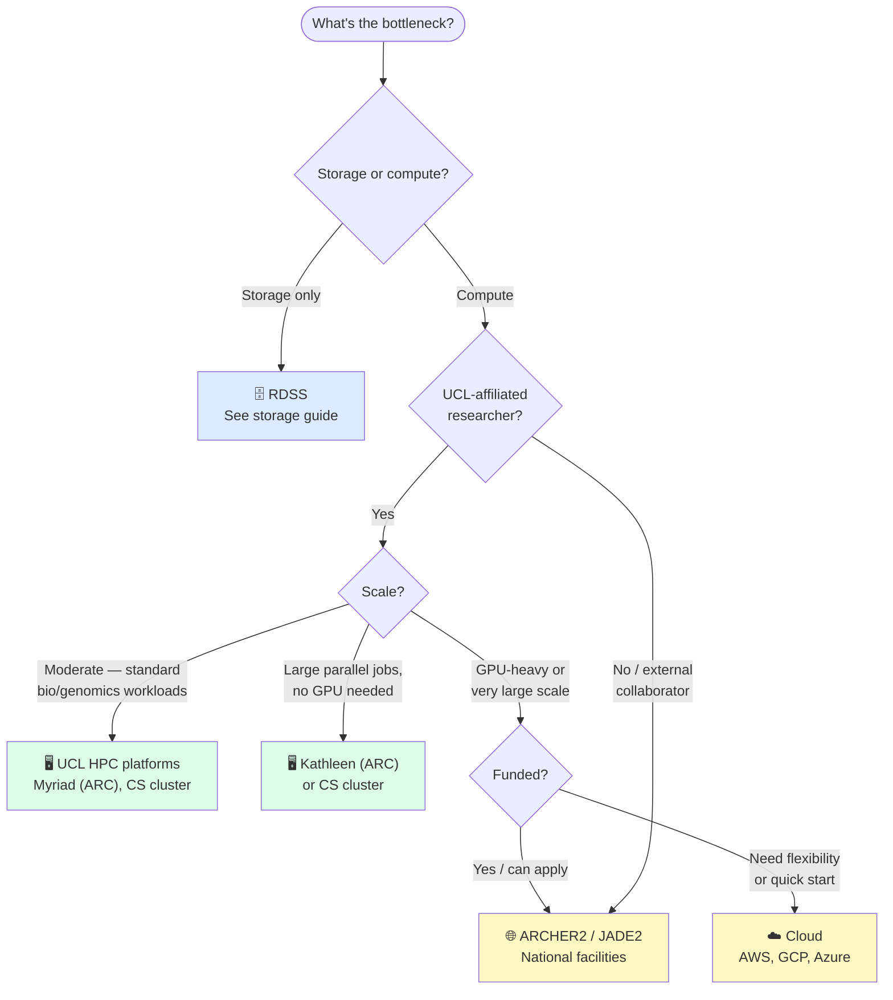

# HPC & Cloud Computing Guide — UCL Biosciences
**Note.** This is a work-in-progress — some details may need updating/amending.

> **Who is this for?** Researchers whose data are too large to store locally, or whose analyses are too slow or memory-hungry to run on a laptop. This guide orients you to the available options and signposts to detailed documentation elsewhere — it does not replace the documentation for individual platforms.

---

## Is HPC what you need?

HPC is not always the answer. Before requesting access, it's worth being clear on the problem:

| Problem | Likely solution |
|---|---|
| Files too large to store on laptop | Project Storages on Computer Science HPC system, which is widely used across Biosciences . RDSS (see storage guide) — you may not need HPC at all |
| Analysis too slow on laptop | HPC compute — see the UCL platforms below |
| Analysis needs more RAM than laptop has | HPC compute — check memory requirements before submitting |
| Analysis needs a GPU | Check availability on UCL platforms, or cloud |
| Need to run hundreds of jobs in parallel | HPC — this is where it excels |
| Collaborators outside UCL need same environment | CS Cluster offers access to external collaborators if they are working with a supported PI |

---

## Which system?



---

## UCL systems at a glance

UCL has two main HPC platforms available to Biosciences researchers: systems managed by [Advanced Research Computing (ARC)](https://www.rc.ucl.ac.uk/) and the [CS HPC cluster](https://hpc.cs.ucl.ac.uk/) managed by the Department of Computer Science. Both are potential options, depending on your funding source.

| System | Best for | Scheduler | Free to use | GPU | More info |
|---|---|---|---|---|---|
| **CS HPC cluster** | Supports general and specialised workflows across many domains, including offering flexible and bespoke solutions across fields in Biosciences and Life Sciences | SGE | Depends on funding | Yes, with support for long-running workloads across multiple processor architectures. | [hpc.cs.ucl.ac.uk](https://hpc.cs.ucl.ac.uk/) |
| **Myriad** | General research computing, most biosciences workloads | SGE | Yes (UCL staff/students) | Yes | [rc.ucl.ac.uk/docs/Clusters/Myriad](https://www.rc.ucl.ac.uk/docs/Clusters/Myriad/) |
| **Kathleen** | High-throughput parallel jobs, large core counts | SGE | Yes (UCL staff/students) | No | [rc.ucl.ac.uk/docs/Clusters/Kathleen](https://www.rc.ucl.ac.uk/docs/Clusters/Kathleen/) |
| **Open OnDemand** | When you want a Jupyter or R Studio interface | N/A | Yes | Yes | [OnDemand Info](https://www.rc.ucl.ac.uk/docs/Supplementary/OnDemand/)  |

---

## Getting access

**CS HPC cluster** — see [hpc.cs.ucl.ac.uk](https://hpc.cs.ucl.ac.uk/) for access procedures. Fill in [this form](https://hpc.cs.ucl.ac.uk/account-form/index.html) to request an account, which is generally confirmed within a few working days (typically within 24 hours). Access eligibility is generally assessed at the Principal Investigator (PI) level, and we are always happy to discuss individual requirements. We also welcome external collaborators working with our supported research groups and laboratories, facilitating seamless collaboration across institutions. 

**Myriad and Kathleen** — request an account via the [ARC self-service portal](https://www.rc.ucl.ac.uk/docs/Account_Services/). You will need a UCL userid. Access is usually granted within a few working days. No cost for standard use.

**National facilities (ARCHER2, JADE2, etc.)** — access is via UKRI allocation. PIs apply through [SAFE](https://safe.epcc.ed.ac.uk/) or the relevant facility portal. Allocations are granted in compute-hours and typically require a short technical case.

**Cloud (AWS, GCP, Azure)** — UCL has framework agreements that may offer discounted or credited access. Contact your faculty research support team to find out what's available. For small-scale or exploratory use, free tiers are often sufficient.

---

## Submitting jobs

### Login nodes vs compute nodes

When you SSH into an HPC system, you land on a **login node** — a shared machine used by everyone for setting up, editing scripts, moving files, and submitting jobs. It is not for running analyses. Running heavy computation on the login node slows it down for all users and your process may be killed without warning.

**Compute nodes** are where your analysis actually runs. To run jobs on compute nodes, you describe what resources you need (cores, memory, time) in a job script, submit it to the queue, and the scheduler allocates you the requested allocation once available.

### GPUs
#### GPUs on CS Cluster
The CS Cluster offers a diverse and continuously expanding range of GPUs, designed to accommodate the computational demands and GPU memory (VRAM) requirements of researchers across UCL and beyond. We recognise that research workloads can be computationally intensive and may require extended runtimes. To support this, the CS Cluster offers generous maximum wallclock limits for GPU jobs, while ensuring fair access to across our users. GPU resources can be requested directly through job scripts, as demonstrated in our [documentation](https://hpc.cs.ucl.ac.uk/gpus/index.html).


GPUs are available on myriad. To submit a job requesting GPUs, see [here](https://www.rc.ucl.ac.uk/docs/Example_Jobscripts/#gpu-job-script-example).

### The basic workflow

Myriad, Kathleen and the CS Cluster use **SGE (Sun Grid Engine)**. If you have used SLURM elsewhere, the concepts are the same but the syntax differs.

1. SSH to the login node
2. Stage your data (e.g. copy from RDSS, transfer with `rsync` or `scp`, or transfer via Globus — see the data sharing guide) ##TO-DO: Not true for CS Cluster, data on our project stores it already mounted for users.
3. Write a job script specifying resources (cores, memory, wall time)
4. Submit with `qsub`
5. Monitor with `qstat`
6. Retrieve outputs and move off scratch promptly

A minimal SGE job script looks like:

```bash
#!/bin/bash -l
#$ -l h_rt=2:00:00        # wall time
#$ -l mem=8G              # RAM per core
#$ -pe smp 4              # number of cores
#$ -cwd                   # run from current directory ##TO-DO: We don't recommend setting this as it can often lead to bugs in 
#$ -o logs/job.out
#$ -e logs/job.err

module load <your_software> ##TO-DO: On CS Cluster software is loaded differently
your_command --input data/ --output results/
```

## More info for getting started
### ARC HPCs
Full ARC documentation including array jobs, GPU requests, and interactive sessions: [rc.ucl.ac.uk/docs/](https://www.rc.ucl.ac.uk/docs/)

> **If you are new to HPC**, ARC run regular introductory training — see the [ARC training pages](https://www.ucl.ac.uk/advanced-research-computing/education/training) before trying to figure things out from scratch.

### CS HPC
Full getting started info is available through the CS cluster [website](https://hpc.cs.ucl.ac.uk/index.html). You will need an account to receive the site login details before accessing this material.

> **If you are new to HPC**, HPC engineers from the CS cluster offer introductory training sessions every Tuesday and Thursday, helping users develop the skills and confidence to run workloads ranging from basic computational tasks to more advanced research workflows.
---

## Storage on HPC - CS Cluster
CS cluster storage is described at [hpc.cs.ucl.ac.uk](https://hpc.cs.ucl.ac.uk/). On the CS Cluster, we offer generous project storage space where researchers can store their data. Importantly, once your data is in a project storage space it's conveniently available across all log-in and compute nodes.

| Type | Purpose | Backed up | Purged |
|---|---|---|---|
| Home Directory | Scripts, config, small files | No | No |
| Project Storage | Long-term research data, any key scripts, files | Upon Request | No |
| Scratch | Temporary files within a single job | No | On job end |

### Moving data to the CS Cluster

We offer data transfer through multiple industry standard tools to convenience our users (below). These can be used for transfers of any size, though we recommend rsync for large transfers. 

- scp
- Filezilla
- rsync
- WinSCP
- Aspera Connect
- Aspera CLI
- Globus Connect Personal

We also have specialised data transfer nodes available to facilitate fast downloads of large datasets.

## Storage on HPC - Myriad

HPC storage is **not** the same as research data storage — see the [storage guide](https://github.com/UCL-Biosciences/Biosciences-Comp-Support/blob/main/UCL_comp_guides/data_storage_at_UCL.md) for RDSS, RDR, and related services. The table below refers to Myriad/Kathleen

| Location | Purpose | Backed up | Purged |
|---|---|---|---|
| `$HOME` | Scripts, config, small files | Yes | No |
| `$SCRATCH` (`/scratch/`) | Job input/output during runs | **No** | No |
| `$TMPDIR` | Temporary files within a single job | **No** | On job end |
| RDSS (mounted) | Long-term research data | Yes | No |

### Myriad ↔ RDSS

RDSS can be accessed directly from Myriad login nodes. See the ISD guide for current setup instructions: [ucl.ac.uk/isd/how-to/rdss-myriad-data-storage-transfer-service](https://www.ucl.ac.uk/isd/how-to/rdss-myriad-data-storage-transfer-service)

### Moving data to/from HPC

- **Small files**: `scp` or `rsync` over SSH to the RDSS or login node
- **Large files**: use Globus (see data sharing guide) — more reliable than rsync for large transfers and can be left unattended
- **From RDSS to scratch before a job**: use `rsync` from the login node to copy from RDSS to scratch. Myriad compute-nodes can't read from RDSS

---

## Software on the CS Cluster

CS Cluster offers a wealth of software, which can be found in /share/apps . This also includes specialized software for bioinformatics, which can be found in /share/apps/genomics

To use installed software, you need to configure two Linux environment variables: **PATH** and **LD_LIBRARY_PATH**.

- **PATH**: Tells Linux where to look for executable programs when you type a command. By adding a software installation's binary (bin) directory to PATH, you can run its commands without specifying their full file paths.

- **LD_LIBRARY_PATH**: Tells the dynamic linker where to look for shared libraries (.so files) required by a program when it starts. In other words, some software depends on libraries installed outside the standard system directories, so their locations must be specified.
  
Below is an example of loading Python version 3.10.0:

```
PATH=/share/apps/python3.10.0-sharedplus/bin:$PATH
LD_LIBRARY_PATH=/share/apps/python3.10.0-sharedplus/lib:$LD_LIBRARY_PATH
```


## Setting up Python environments with venv
We recommend using Python's built-in venv functionality to create lightweight, isolated environments for your projects. These environments are straightforward to manage and help minimise unnecessary overhead on shared HPC infrastructure.

Alternative environment managers, such as Conda, can introduce additional challenges in an HPC environment, particularly due to their storage requirements, large numbers of small files, and filesystem metadata operations. When used extensively across many users, these can place additional pressure on shared storage systems and affect overall performance.

### Setting up a venv
```
# When downloading packages, run a more recent GCC toolchain to support compilation
scl enable devtoolset-11 bash
# Load the version of Python you wish to use
PATH=/share/apps/python3.10.0-sharedplus/bin:$PATH
LD_LIBRARY_PATH=/share/apps/python3.10.0-sharedplus/lib:$LD_LIBRARY_PATH
# Create the venv
python3 -m venv moleRatvenv
# Activate this new venv
source moleRatvenv/bin/activate
# Within the venv, use pip to install required packaes
pip install numpy
pip install matplotlib
# Once finished, get out of the venv
deactivate
```

### Running a pre-existing venv
```
# Importantly, run this at the start of your script if you wish to use the venv
PATH=/share/apps/python3.10.0-sharedplus/bin:$PATH
LD_LIBRARY_PATH=/share/apps/python3.10.0-sharedplus/lib:$LD_LIBRARY_PATH
source moleRatvenv/bin/activate
```

## Software, modules, and containers

The following applies to Myriad and Kathleen.

### Environment modules

Rather than installing software yourself, HPC systems provide a large library of pre-installed, optimised packages via the `module` system. This means you don't need to download or build tools yourself, avoids version conflicts, and ensures you're using builds suited to the cluster hardware. Most common bioinformatics tools (STAR, samtools, GATK, R, Python, etc.) are available — check `module avail` before trying to install anything yourself.

```bash
module avail            # list all available software
module load <name>      # load a package into your environment
module list             # see what's currently loaded
module unload <name>    # remove a package
```

If software you need is not available you can request it via the cluster's support staff or install it yourself (e.g. using conda, see below).

### Conda

For Python and R packages not in the module system, conda environments work well on HPC. Load the UCL-provided miniconda module rather than installing conda yourself:

```bash
module load python/miniconda3/4.10.3
source $UCL_CONDA_PATH/etc/profile.d/conda.sh

conda create -n myenv python=3.11
conda activate myenv
conda install <packages>
```

Build and test your environment on the login node, then activate it in your job script using the same two `module load` / `source` lines before calling your commands.

### Containers (Apptainer / Singularity)

Myriad and CS Cluster supports **Apptainer** (formerly Singularity) for containerised workflows. This is useful when you need a specific software stack, are running a pipeline with a published container image (e.g. from Docker Hub), or want fully reproducible environments. Docker itself is not supported on HPC for security reasons — Apptainer converts Docker images automatically:

```bash
apptainer pull docker://myimage:tag
apptainer exec myimage.sif mycommand
```

---

## When HPC isn't the answer

HPC has a learning curve and is not always the most efficient route. Consider alternatives when:

- **Your analysis is interactive** — HPC batch queues mean waiting; for exploratory work a cloud VM or UCL's virtual desktop may be faster to iterate on
- **You need specialist infrastructure** — clinical data requires the DSH/TRE; some deep learning workloads are better served by JADE2 or cloud GPU instances
- **Your collaborators need access** — national facilities or cloud might be easier to share with external partners than UCL HPC. **Importantly however, the CS Cluster welcome external collaborators working with our supported research groups and laboratories, facilitating seamless collaboration across institutions.**

---

## Further help

| Need | Contact / resource |
|---|---|
| Myriad / Kathleen account, job issues | [rc-support@ucl.ac.uk](mailto:rc-support@ucl.ac.uk) |
| ARC documentation | [rc.ucl.ac.uk/docs](https://www.rc.ucl.ac.uk/docs/) |
| ARC training | [ucl.ac.uk/advanced-research-computing/education/training](https://www.ucl.ac.uk/advanced-research-computing/education/training) |
| CS HPC cluster | [hpc.cs.ucl.ac.uk](https://hpc.cs.ucl.ac.uk/) |
| Myriad ↔ RDSS setup | [ucl.ac.uk/isd/how-to/rdss-myriad-data-storage-transfer-service](https://www.ucl.ac.uk/isd/how-to/rdss-myriad-data-storage-transfer-service) |
| RDSS general, data movement | [researchdata-support@ucl.ac.uk](mailto:researchdata-support@ucl.ac.uk) |
| National facility applications | [rc-support@ucl.ac.uk](mailto:rc-support@ucl.ac.uk) |
| Cloud access / UCL agreements | Contact ARC or faculty research support |
